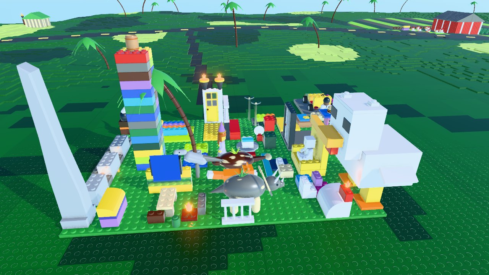
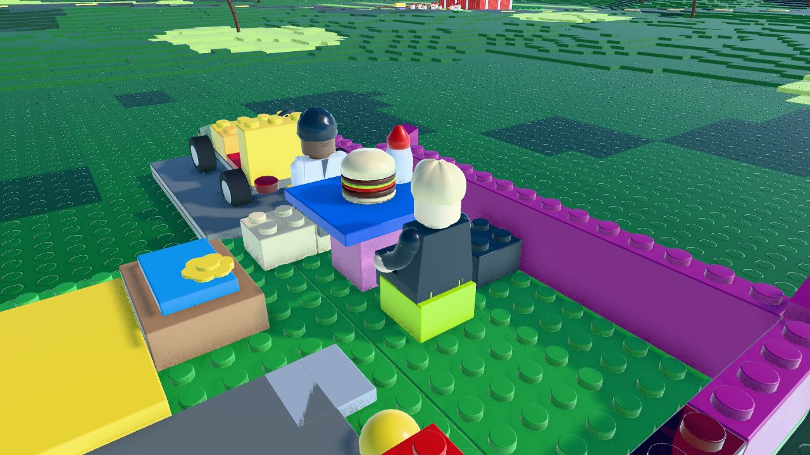
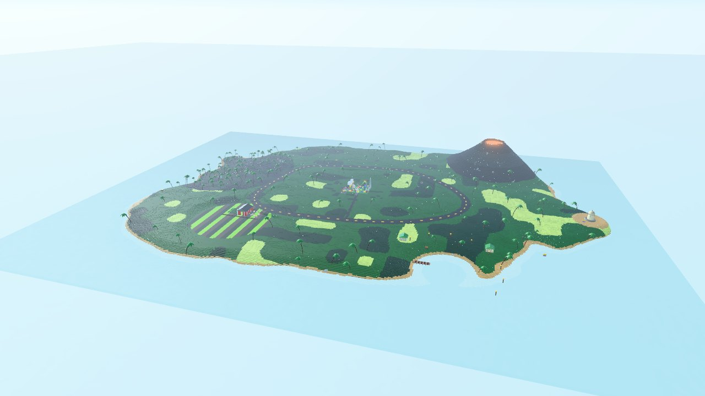
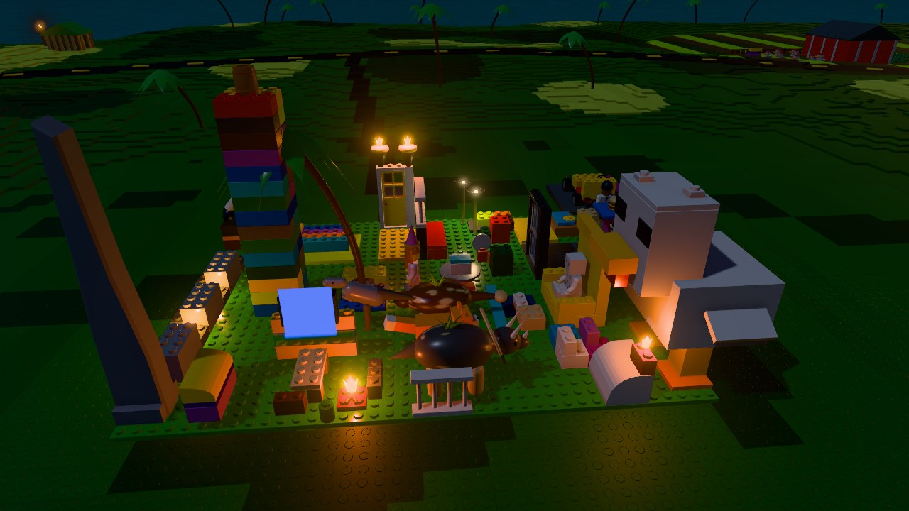

# Luxury Dreamhouse

A brick house built on a living-room rug, turned into an open-world game in the browser. Hugo (the dad) and Dada (the son) walk round the house, go in through the front door, sit down to burgers at the table, drive the kart, ride the dinosaurs and explore **Dreamhouse Island**, a world made entirely of bricks. three.js `WebGPURenderer` (WebGL 2 fallback), Rapier physics, no downloaded assets: every brick, figure and wave is generated in code.



## Play

**https://webgpu-demos.github.io/luxury-dreamhouse/**

| | |
|---|---|
| `W A S D` | walk; drive the kart; steer a dinosaur |
| Mouse / wheel | look / zoom (click to capture the mouse) |
| `Shift` / `Space` | run / jump (handbrake in the kart) |
| `E` | doors, seats, the kart, dinosaurs, treasure chests, lights, talk |
| `Tab` | switch Hugo / Dada / Princess / Blocky |
| `N` / `T` | day or night / one hour on |
| `P` | photo mode (macro depth of field) |
| `Q` | quality tier (high: GTAO + bloom + 4x MSAA; medium; low) |
| `B` | **As built**: hide everything that is not in the photographed build |
| `R` | back to the front door |
| `H` | help |

Whichever of Hugo and Dada you aren't playing follows you: he stands up from the table when you leave, sits opposite you when you sit down, and jumps into the kart's passenger seat when you drive off.

## From photos to bricks (scan-to-BIM, with LDraw as the element library)

The 19 photos of 2026-10-11 (`IMG_7105` to `IMG_7123`, iPhone 15) are the scan. The build is the "building": every part sits on a lattice of 8 mm (stud pitch) by 3.2 mm (plate height), so modelling it means snapping parts to a grid, not sculpting.

1. **Orthophoto.** `IMG_7109` (top-down) is rectified to the baseplate plane with a keystone-corrected grid fitted to visible studs (`tools/ortho.py`). The output is a 47 x 32 stud grid ([`docs/ortho_grid.png`](docs/ortho_grid.png)). Every element's footprint is read off it in stud cells; heights come from the oblique photos, counted in bricks and plates.
2. **Model.** `src/house/house.js` places the parts in stud and plate units with a procedural brick kit (`src/bricks/kit.js`):
   - bricks, plates, tiles, slopes, curved slopes and rounds have 0.1 mm clearances and bevelled edges;
   - studs are instanced, and studs hidden under another part are culled;
   - special parts are procedural (`src/bricks/parts.js`): flames, torches, lanterns, the barrel, palms, the spire, the horn, the chest, the kart.
3. **Element registry.** [`docs/elements.json`](docs/elements.json) holds one entry per element. Each entry records:
   - class (Door, Wall, Seat, Vehicle, Light, Creature, Container, Prop, Plant, Figure) and zone;
   - stud cells;
   - affordances (open, sit, drive, ride, ignite, sleep, talk);
   - the photos that show it;
   - confidence;
   - **provenance**: `as-built` (30), `inferred` (4: moulded animals) or `extension` (3: kart wheels, driveway, garage bay). The game's interactions are wired from it.
4. **Level of detail.** The house is at LOD 200+: rectangular parts are on the lattice and special parts are approximated. Exact LDraw part numbers (LOD 300) and printed parts (LOD 350) need the full photo capture (see below).

**Deviations, stated plainly:**
- **Plates.** The main plate reads as 40 x 32 studs and the dining room sits on a 7 x 16 extension. The seams between plates are not visible in the photos, so they are unverified.
- **Moulded animals.** The dinosaurs and the fox are moulded toys with no LDraw model, so they are procedural stand-ins (`inferred`).
- **The kart.** It sits in the dining room as built. It has no wheels in the photos, and its wheels are an extension (`B` hides them). For play it is parked in the extension garage bay.
- **Guesses.** The "TV" (yellow and trans-light-blue wall), the "sofa", the "jail cell" and the "kitchen stack" are readings of the photos. The builder's narrated tour will settle them.



## Dreamhouse Island

The island is invented, built from bricks and themed on the build itself. The world is a grid of baseplates, about 350 x 260 m at minifig scale (`src/world/island.js`, seeded, so everyone gets the same island):

| Zone | What's there |
|---|---|
| Dreamhouse Estate | the scanned house on a plateau; driveway down to the ring road |
| Ring road | a loop round the island, with its height profile smoothed along the loop so the kart can drive it |
| The Volcano | stepped cone; lava that glows at night and lights the slopes |
| Dino Jungle | dense palms, ruins with lanterns, a herd of the build's dinosaurs |
| Chicken Farm | striped fields, a barn, fences, smaller chickens |
| Tiki Beach & Lagoon | dock, two huts, tiki torches along the shore |
| Lookout Point | a sandstone garita on the headland |

There are nine treasure chests to find (the counter is top right).

- **Terrain.** 2 x 2-stud cells, heights quantised to plates. Merged top quads and side walls, in 64-cell chunks.
- **Studs on terrain and water.** These are *shaded*, not modelled: an analytic stud height field on the lattice gives the normal and a contact ring, faded with distance so it never shimmers (`src/world/studs.js`). Real stud geometry is kept for the house and props.
- **Water.** Transparent light-blue "plates" with studs and a slow ripple.




## Engine

| Layer | Choice |
|---|---|
| Renderer | three.js 0.186 `WebGPURenderer` + TSL; WebGL 2 fallback (`?webgl` forces it) |
| Look | ABS plastic (`MeshPhysicalNodeMaterial`, clearcoat, roughness varied by noise); physical sky with clouds (`SkyMesh`) and a sky-lit environment map; sun shadows; GTAO; emissive-only bloom for flames; Neutral tone mapping |
| Lights | a fixed pool of 8 point lights assigned every half second to the nearest sources (torches, lanterns, campfire, lamps, volcano), so lights never change the shader |
| Physics | Rapier (`rapier3d-compat`, single-threaded: GitHub Pages can't send COOP/COEP); heightfield terrain, box colliders from the brick kit, kinematic doors that follow their hinges, character controllers for figures, animals and the kart |
| Figures | minifigs rigged at the real joints (neck, shoulders, wrists, hips); procedural stiff-leg walk; printed face and torso textures |
| Quality | high / medium / low tiers, and a governor that steps down when frames stay over 28 ms |

## Run, test, deploy

```
npm install
npm run dev          # http://127.0.0.1:5290
npm run build        # dist/ (about 2 MB gzipped, one file: nothing to download besides the code)
npm run deploy       # build and force-push dist/ to gh-pages (Pages serves it at /luxury-dreamhouse/)
node tools/shot.mjs http://127.0.0.1:5290/ hero,chicken,dining,night,island "quality=high&webgl=1"
node tools/playtest.mjs   # scripted logic test (22 checks) + regenerates docs/elements.json
```

URL parameters:
- `?shot=hero|low|top|dining|chicken|kart|island|volcano|beach|night` (fixed cameras for stills)
- `?play=1`, `?time=20.5`, `?quality=low|medium|high`, `?asbuilt=1`, `?webgl=1`

## Next

See [PLAN.md](PLAN.md).
- **LOD 300.** Exact parts, checked against a full photo capture by reprojection deviation: render the model from each solved camera and diff it with the photo.
- **Builder's tour.** The builder's narrated tour becomes the affordances.
- **The island.** Wave refraction in the lagoon, more of the island.
- **Build mode.** Place bricks on studs.

Fan project; not affiliated with any toy company. MIT licence.
